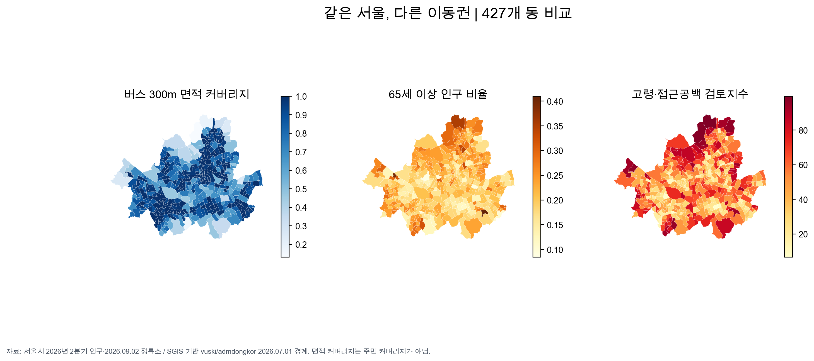

# 같은 서울, 다른 이동권

**고령인구와 버스 접근 공백의 중첩을 통한 개선 우선지역 분석**

서울 427개 행정동의 고령인구 비율과 버스정류소 접근 범위를 비교해, 고령자의 일상 이동을 위한 현장검토 우선지역을 제안합니다. 「AI와 함께하는 교통문제 해결을 위한 데이터 분석 공모전」에 제출한 분석의 코드·입력자료·결과를 담은 저장소입니다.

- 분석자: 백진우 · 개인 참가
- 분석 단위: 서울 427개 행정동
- 분석 기준: 2026년 자료, 실행일 2026년 10월 22일
- 주요 방법: 공간 중첩, 상대지수, 민감도 분석, 상관·공간통계, 조건부 정류소 보완 시뮬레이션

## 핵심 결과

| 확인한 내용 | 결과 | 해석 |
| --- | --- | --- |
| 버스정류소 300m 반경의 동별 면적 커버리지 중앙값 | 94.82% | 주민 수 기준 접근률과는 다른 지표 |
| 서울 전체 면적을 기준으로 계산한 커버리지 | 72.20% | 면적이 큰 비주거 공간의 영향 포함 |
| 고령비율과 접근 공백이 모두 동별 중앙값 이상인 지역 | 118개 동 | 법정 취약지역이 아닌 상대적 검토 대상 |
| 반경·가중치 9개 조건에서 기준 상위 10개와 겹치는 동 | 8~10개 | 후보 선정의 조건 민감도 확인 |
| 운행횟수는 빈칸인데 같은 행·시간의 승차량이 양수인 사례 | 14,509건 | 공급 결측을 0으로 처리하지 않은 근거 |

도봉1동·우이동·방화3동·상계3·4동·관악구 삼성동은 9개 조건 모두에서 상위 10개에 포함됐습니다. 정책 적용 전에는 해당 동의 주거지 분포, 보행 경사·횡단 여건, 주민이 실제로 겪는 불편을 확인해야 합니다.



전체 결과는 [행정동별 지표](output/final_analysis/dong_screening_all.csv), [현장검토 우선후보](output/final_analysis/top10_review_candidates.csv), [거리·가중치 민감도](output/final_analysis/index_sensitivity.csv)에서 확인할 수 있습니다.

## 분석 질문과 지표

핵심 질문은 **“고령인구 비율이 높으면서 버스 시설 접근 공백도 큰 지역은 어디인가?”**입니다.

1. 정류소별 300m 직선 반경을 합쳐 각 동과 겹치는 면적을 계산합니다. 동 밖의 가까운 정류소도 반영합니다.
2. 고령비율과 접근 공백의 백분위 순위를 같은 비중으로 결합합니다.
3. 반경·가중치와 지하철역 반경을 바꿔 후보 선정의 안정성을 검토합니다.
4. 운행·승차 자료의 결합과 결측을 확인하고, 가상 정류소 추가에 따른 면적 변화를 계산합니다.

```text
고령비율 E = 65세 이상 인구 / 전체 등록인구
접근 공백 U = 1 − 정류소 300m 반경 내 동 면적 / 동 전체 면적
우선 검토지수 = 100 × [0.5 × E의 백분위 순위 + 0.5 × U의 백분위 순위]
```

우선 검토지수는 현장 확인의 순서를 정하기 위한 상대지표입니다. 주민 개인의 이동 불편을 예측하는 머신러닝 모델은 학습하지 않았습니다.

## 데이터

| 데이터 | 제공기관·출처 | 기준시점 | 사용 목적 |
| --- | --- | --- | --- |
| [서울시 등록인구 통계](https://stat.eseoul.go.kr/statHtml/statHtml.do?orgId=201&tblId=DT_201004_O020003&conn_path=I2) | 서울특별시 · 서울통계 | 2026년 2분기 | 전체·65세 이상 인구 |
| [버스정류소 위치정보](https://data.seoul.go.kr/dataList/OA-15067/F/1/datasetView.do) | 서울특별시 · 열린데이터광장 | 2026-09-02 | 정류소 위치·접근 범위 |
| [노선별 정류소 정보](https://data.seoul.go.kr/dataList/OA-1095/S/1/datasetView.do) | 서울특별시 · 열린데이터광장 | 2026-09-02 | 노선·정류소·경유순번 연결 |
| [노선별 정류장별 총 버스 운행횟수](https://data.seoul.go.kr/dataList/OA-21220/S/1/datasetView.do) | 서울특별시 · 열린데이터광장 | 2026-09-21~27 | 시간대별 관측 공급·결측 |
| [노선별 정류장별 승차 인원](https://data.seoul.go.kr/dataList/OA-21219/S/1/datasetView.do) | 서울특별시 · 열린데이터광장 | 2026-09-21~27 | 승차 기록·공급 결합 점검 |
| [지하철역_GEOM](https://t-data.seoul.go.kr/dataprovide/trafficdataviewfile.do?data_id=36) | 서울특별시 TAIMS · T Data | 2026-10-22 확보, 개별 기준일 미제공 | 철도 시설 반경 추가 검토 |
| [행정동 경계 가공본](https://github.com/vuski/admdongkor/blob/master/ver20260701/HangJeongDong_ver20260701.geojson) | SGIS 원자료 · vuski/admdongkor 가공 | 2026-07-01 | 행정동 연결·면적 계산 |

인구는 공식 공개 HTML 표를 보존한 자료이며 XLSX 다운로드본이 아닙니다. 427개 동의 값과 25개 자치구·서울 합계를 대조했습니다. 경계는 SGIS 원자료를 가공한 공개본을 사용했습니다. 파일 해시와 상세 출처는 [원본 목록](output/final_analysis/raw_manifest.json)과 [출처·이용조건](output/final_analysis/sources.json)에 기록했습니다.

## 조건부 정류소 보완 시나리오

우선후보 10개 동에서 기존 노선의 연속 정류소 사이에 가상 정류소를 추가하는 시나리오를 검토했습니다. 같은 동 안의 연속 정류소 간 직선 간격이 600~1,200m이고, 중점이 모든 기존 정류소의 300m 범위 밖인 경우만 후보로 삼았습니다. 거리 기준은 연구상 가정입니다.

중복 제거 후 남은 후보는 방화2동의 가상 중점 1개였습니다. 이 후보에 실제 서비스가 제공된다고 가정하면 방화2동 면적 커버리지는 **37.6465% → 39.5508%, 1.9043%p 증가**합니다. 추가 면적은 약 117,721m²입니다.

면적 커버 최대화 입지모형(MCLP)을 이진 혼합정수계획으로 계산했습니다. 후보가 1개뿐이어서 최대 1·3·5개 조건의 결과는 같았으며, 여러 입지 조합의 개선 효과를 비교할 수는 없었습니다. 도로선형·정차 안전·주거지 여부는 미확인으로, 실제 설치 추천이나 승객 증가 예측으로 해석하지 않습니다.

[시나리오 결과](output/location_simulation/installation_scenarios.csv) · [동별 전후 비교](output/location_simulation/dong_before_after.csv) · [상세 방법과 한계](output/location_simulation/추가분석_설명.md)

## 실행 방법

Python 3.11 이상 환경에서 저장소 루트를 기준으로 실행합니다.

```bash
git clone https://github.com/BeakJW/seoul-elderly-transit-access.git
cd seoul-elderly-transit-access
python -m venv .venv
source .venv/bin/activate
python -m pip install -r requirements.txt

python scripts/prepare_inputs.py
python scripts/analyze_elderly_access.py
python scripts/verify_common_date_boarding_supply.py
python scripts/verify_final_analysis.py
python scripts/simulate_stop_locations.py
```

Windows의 가상환경 활성화 명령은 `.venv\Scripts\activate`입니다.

`prepare_inputs.py`는 압축된 경계 원본을 복원하고 SHA256을 확인합니다. 메인 분석 코드는 승차·운행횟수 CSV가 없으면 제공 ZIP에서 해당 파일을 풉니다. 이미 있는 파일은 덮어쓰지 않습니다. 입력자료를 다시 내려받기 위한 인증키는 필요하지 않습니다.

한글 그림을 생성하려면 한글 글꼴이 필요합니다. 기본 경로는 macOS의 Arial Unicode이며, 다른 환경에서는 설치된 글꼴의 TTF 경로를 `KOREAN_FONT` 환경변수로 지정합니다. 글꼴 파일은 저장소에 포함하지 않았습니다.

공식 표 양식의 편집 가능한 보고서를 생성하려면 다음을 실행합니다.

```bash
python scripts/build_submission_report.py
```

이 명령은 `output/submission/백진우_분석보고서.docx`를 생성합니다. PDF는 한글 글꼴이 설정된 Word 또는 LibreOffice에서 내보낸 뒤 표·그림·쪽 나눔을 확인합니다.

## 저장소 구조

```text
├── data/
│   ├── raw/                       # 분석 입력자료와 원본 ZIP
│   └── template_assets/           # 공모전 제공 양식의 로고
├── scripts/                       # 입력 준비·분석·검증·보고서 작성
├── output/
│   ├── final_analysis/            # 행정동별 지표·검증 결과·그림
│   └── location_simulation/       # 가상 정류소 시나리오 결과
├── AI_사용기록.md
├── environment.json
└── requirements.txt
```

## 해석 범위와 정책 활용

- 면적 커버리지는 인구 커버리지와 다릅니다. 산지·하천·공원 등이 분모에 포함되며, 후보 동의 전체 고령인구를 사업 수혜자로 계산하지 않습니다.
- 직선 반경은 경사·횡단·보행 안전·대기시간을 반영하지 않습니다. 버스 좌표계의 공식 설명 충돌은 미해결이며, 경위도 값을 EPSG:4326으로 해석하고 거리·면적을 EPSG:5179에서 계산했습니다.
- 운행횟수 빈칸은 결측으로 유지했습니다. 공급 기록의 존재율과 시간별 완전성을 구분하고, 불완전한 공급량은 종합지수에서 제외했습니다. 정류소 서비스 횟수의 합은 고유 차량 수가 아닙니다.
- 자료 간 기준시점이 다르며, 1주 기록을 연간 특성으로 일반화하지 않습니다. 지하철은 등재 위치 반경만 보완했으며 출입구·엘리베이터·운행 빈도는 반영하지 못했습니다.
- 승용차 수단전환·주행거리 자료가 없어 탄소감축량을 산출하지 않았습니다. 정책 적용 시에는 회피된 승용차 배출과 추가 버스 운행 배출을 함께 평가해야 합니다.

정책 검토는 고령 주민의 목적지와 통행 포기 경험 확인, 보행환경·기존 노선 보완안 비교, 소규모 시범사업의 전후 평가 순서로 제안합니다.

## AI 활용과 이용조건

OpenAI Codex를 연구 질문 구체화, 데이터 검토, 분석·검증 코드 작성과 실행, 시각화, 결과 해석·정책 초안 및 보고서 작성에 활용했습니다. 활용 범위와 주요 분석 프롬프트는 [AI 사용 기록](AI_사용기록.md)에 정리했습니다.

데이터 이용 시 원 제공기관의 조건을 따릅니다. 서울시 원본의 공공누리 제1유형 및 T Data의 저작자표시 조건을 보존합니다. 경계는 [통계청 SGIS](https://sgis.kostat.go.kr)에서 공공누리 제1유형으로 개방한 행정동 경계를 [vuski/admdongkor](https://github.com/vuski/admdongkor)가 가공한 자료이며, 가공본은 [CC BY 4.0](https://github.com/vuski/admdongkor/blob/master/LICENSE-DATA)으로 배포됩니다. 본 분석에서는 서울 영역을 추출하고 지표를 결합했습니다.

공모전 양식의 로고는 해당 제출 양식 작성용입니다. 저장소에 포함됐다는 이유로 일반적인 로고 이용 권한이 부여되는 것은 아닙니다. 개인정보가 포함된 참가신청서와 자필 서명은 이 저장소에 포함하지 않았습니다.
